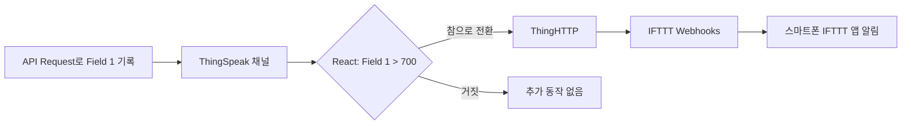
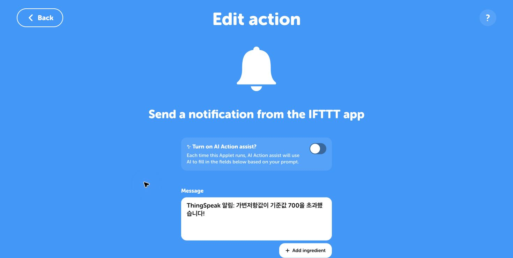
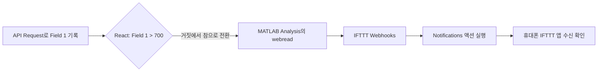
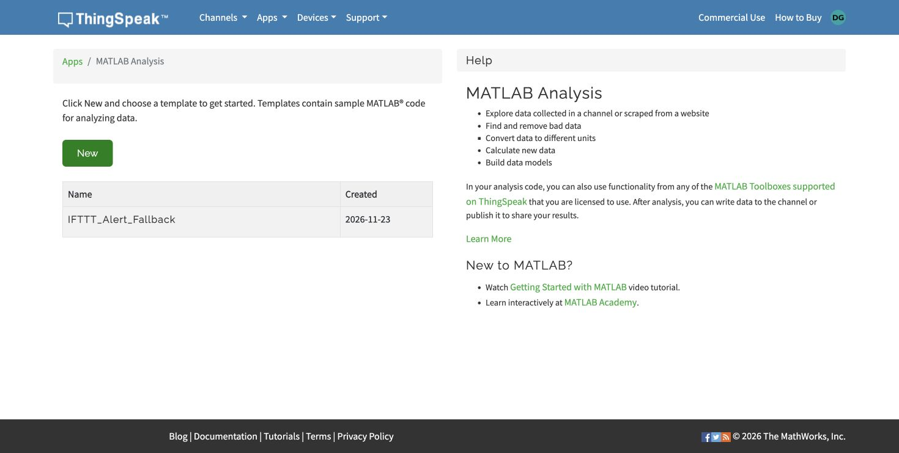
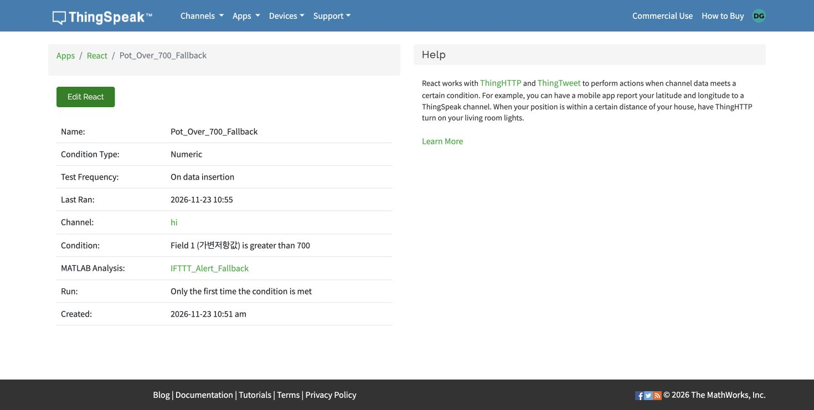
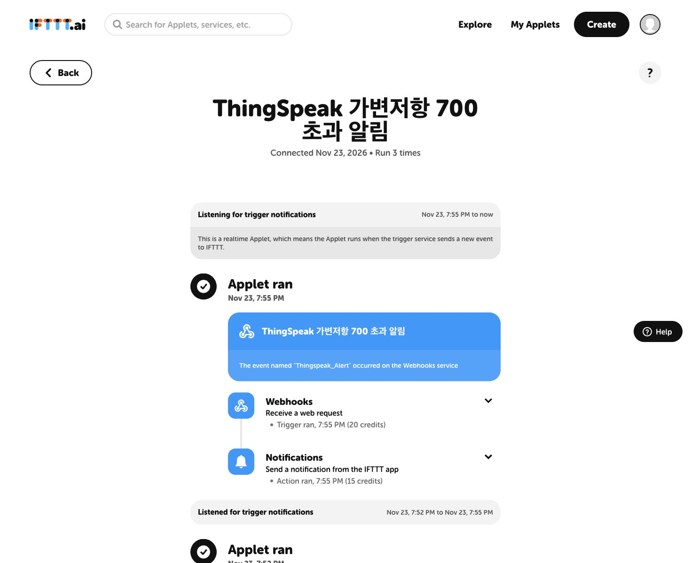

# ThingSpeak와 IFTTT를 이용한 휴대폰 알림

ThingSpeak 채널에 기록한 가변저항값이 **700을 초과할 때** IFTTT 앱으로 알림을 보내는 실습입니다. 채널 데이터 저장, 조건 판단, Webhook 호출, 모바일 알림의 연결 과정을 정리했습니다.

> **실습 결과 · 2026년 11월 23일:** **대체 경로 `React → MATLAB Analysis → IFTTT`의 자동 실행 2회와 휴대폰의 실제 수신을 확인했습니다.** 700에서는 실행되지 않았고, 950에서는 중복 실행이 없었으며, 500으로 내린 뒤 900으로 올리면 다시 실행됐습니다. **원래 과제의 ThingHTTP 저장은 HTTP 503 오류로 미완료**입니다. 휴대폰 수신은 마지막 19:55 자동 시험에 대해 사용자가 확인했습니다.

## 1. 동작 원리

아래는 과제에서 요구한 원래 경로입니다. 실제로 시험한 대체 경로는 [9절](#9-thinghttp-장애에-대응한-대체-연동)에 구분해 정리했습니다.



이번 실습은 API URL로 값을 직접 기록하므로 Arduino나 센서를 연결하지 않아도 조건 알림을 시험할 수 있습니다. 직접 입력한 값은 실제 센서 측정값과 구분합니다.

## 2. 실습 대상과 설정안

| 항목 | 값 |
|---|---|
| ThingSpeak 채널 | 기존 채널 `hi` |
| Channel ID | `3565315` |
| Field 1 | `가변저항값` |
| Field 2 | `LED 상태값` · 이번 시험에서는 수정하지 않음 |
| 알림 조건 | Field 1 **> 700** |
| IFTTT Event Name | `Thingspeak_Alert` |
| ThingHTTP 이름 | `IFTTT_Thingspeak_Alert` |
| React 이름 | `Pot_Over_700_Notification` |

기준값 700은 이번 실습용으로 정했습니다. `>` 비교이므로 정확히 700일 때는 알림 조건을 만족하지 않습니다.

## 3. IFTTT Applet 설정

1. [IFTTT](https://ifttt.ai/)에 로그인하고 **Create**에서 Applet을 만듭니다.
2. **If This → Webhooks → Receive a web request**를 선택합니다.
3. Event Name에 `Thingspeak_Alert`를 입력합니다. **Receive a web request with a JSON payload**와 구분합니다.
4. **Then That → Notifications → Send a notification from the IFTTT app**을 선택합니다.
5. 알림 문구를 다음과 같이 지정하고 Applet을 활성화합니다.

```text
ThingSpeak 알림: 가변저항값이 기준값 700을 초과했습니다!
```

실제로 생성한 Applet의 이름은 `ThingSpeak 가변저항 700 초과 알림`, ID는 `uEeqPN2f`입니다. 저장된 이벤트와 알림 문구를 편집 화면에서 다시 확인했습니다.





휴대폰의 IFTTT 앱에도 같은 계정으로 로그인하고 알림을 허용합니다. Webhooks 서비스의 **Documentation**에서 개인 키와 호출 주소를 확인합니다. 서비스 화면과 이용 가능 범위는 현재 계정에서 확인합니다.

```text
https://maker.ifttt.com/trigger/Thingspeak_Alert/with/key/<IFTTT_WEBHOOK_KEY>
```

이 주소로 직접 호출하면 **조건 검사 없이** Applet 연결만 시험합니다. 응답이 성공이어도 휴대폰에서 알림이 도착했는지 별도로 확인합니다. [IFTTT Webhooks 설명](https://ifttt.ai/maker_webhooks)

2026년 11월 23일 19:40(한국 시간)에 직접 호출했고, 성공 응답과 IFTTT 실행 이력의 `Trigger ran`, `Action ran`을 확인했습니다. [직접 호출 기록](evidence/ifttt-direct-test.json)


## 4. ThingHTTP 연결

ThingSpeak의 **Apps → ThingHTTP → New ThingHTTP**에서 다음과 같이 설정합니다.

| 항목 | 입력 |
|---|---|
| Name | `IFTTT_Thingspeak_Alert` |
| URL | 위 Webhooks 주소의 키를 본인 키로 치환한 실제 주소 |
| Method | `GET` |
| HTTP Version | `1.1` |
| HTTP Auth Username / Password | 비워 둠 |
| Content Type / Host / Headers / Body / Parse String | 비워 둠 |

**Save ThingHTTP**로 저장합니다. ThingHTTP는 IFTTT 호출을 담당하고, 센서값 비교는 다음 단계의 React가 담당합니다. [ThingHTTP 공식 문서](https://www.mathworks.com/help/thingspeak/thinghttp-app.html)

### 실제 저장 시 발생한 오류

요청 `238493`의 편집 화면에 위 값을 입력했지만 저장 시 `HTTP ERROR 503`이 발생했습니다. 새 편집 화면과 빈 헤더 정리 후에도 같은 오류가 나타났고, 목록에서 이름이 여전히 `Request 238493`인 것을 확인했습니다. 따라서 ThingHTTP 연결 저장 성공으로 표시하지 않았습니다.


[MathWorks 문답](https://www.mathworks.com/matlabcentral/answers/2185362-thinghttp-save-delete-returns-http-error-503)에는 11월 18일 동일한 저장 오류가 보고되었고, 11월 21일에도 계속된다는 후속 글이 있습니다. 답변에는 MATLAB Analysis의 `webread`를 이용한 대체 방식이 제안되어 있습니다. [상태 페이지](https://status.mathworks.com/)는 확인 당시 정상으로 표시되어, 현재 오류와 전체 서비스 상태를 구분했습니다.

## 5. React 조건 등록

**Apps → React → New React**에서 설정합니다.

| 항목 | 입력 |
|---|---|
| React Name | `Pot_Over_700_Notification` |
| Condition Type | `Numeric` |
| Test Frequency | `On Data Insertion` |
| If channel | `hi (3565315)` |
| Field | `1 (가변저항값)` |
| 비교 | `is greater than` |
| 기준값 | `700` |
| Action | `ThingHTTP` |
| then perform ThingHTTP | `IFTTT_Thingspeak_Alert` |
| Options | `Run action only the first time the condition is met` |

**Save React**로 저장합니다. 이 옵션은 조건이 거짓이었다가 참이 될 때 실행하므로, 900 이후 950을 기록해도 반복 알림을 방지합니다. 이후 500으로 내린 뒤 900으로 올리면 다시 실행 대상이 됩니다. [React 공식 문서](https://www.mathworks.com/help/thingspeak/react-app.html)

## 6. API Request로 값 기록

채널의 **API Keys → API Requests → Write a Channel Feed** 주소에서 `field1`을 변경합니다. 채널의 **Write API Key**를 사용하며, IFTTT 키나 ThingHTTP 키와 구분합니다.

```text
https://api.thingspeak.com/update?api_key=<THINGSPEAK_WRITE_API_KEY>&field1=500
https://api.thingspeak.com/update?api_key=<THINGSPEAK_WRITE_API_KEY>&field1=700
https://api.thingspeak.com/update?api_key=<THINGSPEAK_WRITE_API_KEY>&field1=900
```

요청은 한 번에 하나씩 보내며, 재현 시 **20초 이상** 간격을 권장합니다. 무료 라이선스의 채널 갱신 최소 간격은 15초이며 계정별 제한을 따릅니다. 응답이 양의 정수이면 새 `entry_id`, `0`이면 기록 실패입니다. `200 OK`만으로 기록 성공을 판단하지 않습니다. [데이터 기록 API](https://www.mathworks.com/help/thingspeak/writedata.html), [API 제한](https://www.mathworks.com/help/thingspeak/channel-control.html)

### 실제 시험 결과

먼저 React 등록 전 API 기록 단계만 시험했습니다. 19:31:12, 19:31:49, 19:32:20(한국 시간)에 500·700·900이 각각 entry 20·21·22로 저장되었습니다. [초기 API 기록](evidence/live-channel-writes.json)

이후 **대체 경로의 React를 저장한 뒤** 아래 순서로 전체 흐름을 시험했습니다. 표의 실행 결과는 IFTTT 서버의 Notifications 액션 기준이며, 마지막 19:55 실행의 휴대폰 수신은 별도로 사용자 확인을 받았습니다.

| 순서 | Field 1 | entry ID | 입력 시각 KST | IFTTT 추가 실행 | 확인 내용 |
|---|---:|---:|---|---|---|
| 1 | 500 | 23 | 19:51:44 | 0회 | 조건 거짓 |
| 2 | 700 | 24 | 19:52:24 | 0회 | 경계값도 거짓 |
| 3 | 900 | 25 | 19:52:39 | 1회 | 첫 초과 시 실행 |
| 4 | 950 | 26 | 19:53:29 | 0회 | 참 유지 시 중복 방지 |
| 5 | 500 | 27 | 19:54:18 | 0회 | 조건 초기화 |
| 6 | 900 | 28 | 19:55:11 | 1회 | 다시 초과하면 재실행 |

[실제 채널 기록](evidence/live-fallback-writes.json), [IFTTT 실행 기록](evidence/fallback-activity.json)에서 확인할 수 있습니다. IFTTT 총 실행은 직접 시험 1회(19:40)와 대체 경로 자동 실행 2회(19:52, 19:55)를 합해 3회입니다.

알림 도착 시간은 서비스나 휴대폰 상태에 따라 달라질 수 있습니다. 입력 시각, 새 entry ID, IFTTT 실행 이력, 휴대폰 알림을 함께 비교합니다.

### 선택 사항 · Python으로 같은 시험 실행

Python 3 표준 라이브러리만 사용하는 [test_channel.py](test_channel.py)를 제공합니다. 기본 실행은 계획을 출력하며 네트워크 요청을 보내지 않습니다.

```sh
python3 test_channel.py
python3 test_channel.py --execute
```

`--execute`는 해당 채널에 위 여섯 값을 실제로 기록합니다. 실행 중 해당 채널의 Write API Key를 숨김 입력하며, 20초 간격으로 기록합니다. 로그는 키를 제외하고 `evidence/channel-writes-실행시각.json`에 저장합니다. 이 로그는 **채널 기록 성공**만 증명하며 모바일 알림 수신 증거는 아닙니다.

## 7. 제출 전 확인할 증빙

- [x] Applet의 Webhooks 이벤트와 Notifications 액션
- [x] Applet 활성 상태
- [ ] ThingHTTP 연결 저장 화면 · 모든 키 가림
- [x] 대체 경로 React의 채널·필드·비교식·실행 옵션
- [x] 500·700·900 기록 결과와 entry ID
- [x] IFTTT 실행 이력과 휴대폰의 실제 알림 · 최종 자동 시험 사용자 확인
- [x] 대체 경로의 실제 시험 결과로 위 표 갱신
- [x] GitHub 자료 공개
- [ ] 실제 연동 확인 후 과제 게시글에 링크 제출

알림 화면에는 이번 실습 문구와 시각이 보이도록 하고, 참고 링크의 타인 화면을 본인 결과로 사용하지 않습니다. 공개 자료에는 Webhook 키, 채널 Write/Read API Key, ThingHTTP 키를 넣지 않습니다.

## 8. 알림이 오지 않을 때

1. 채널 기록 응답이 `0`이면 Write API Key, 기록 간격, 활성 필드를 확인합니다.
2. 채널에 900이 저장되었는지 확인한 뒤 React의 `> 700`, `On Data Insertion`, 연결된 ThingHTTP를 점검합니다.
3. 첫 전환 옵션을 사용 중이면 500을 기록하고 간격을 둔 뒤 900으로 다시 시험합니다.
4. IFTTT 이벤트의 대소문자, Applet 활성 상태와 실행 이력을 확인합니다.
5. 휴대폰 앱 계정과 OS 알림 허용, 집중 모드 등을 확인합니다.

이번 실습에서는 첫 직접 시험 알림이 수신되지 않아 계정 `god640388`과 알림 허용을 확인했습니다. 이후 **19:55 자동 시험 알림은 휴대폰에 도착했다고 사용자가 확인했습니다.** 휴대폰 수신은 사용자 확인으로 기록했으며, 휴대폰 화면 캡처는 첨부하지 않았습니다.

## 9. ThingHTTP 장애에 대응한 대체 연동

사용자 동의를 받아 ThingSpeak의 MATLAB Analysis가 Webhook을 호출하도록 구성했습니다. 과제에서 지정한 ThingHTTP 경로와는 다르며, ThingHTTP 저장 성공으로 대체 기록하지 않았습니다.



| 항목 | 실제 저장한 값 |
|---|---|
| MATLAB Analysis 이름 | `IFTTT_Alert_Fallback` |
| MATLAB Analysis ID | `431384` |
| React 이름 | `Pot_Over_700_Fallback` |
| React ID | `139875` |
| 조건 | 채널 3565315 / Field 1 / Numeric / `is greater than 700` |
| 검사 시점 | `On Data Insertion` |
| 실행 대상 | `MATLAB Analysis → IFTTT_Alert_Fallback` |
| 실행 옵션 | `Only the first time the condition is met` |

비공개 편집기에 저장한 코드는 `webread`로 본인의 Webhook URL을 요청하고 결과를 출력합니다. 실패 메시지에 키가 노출되지 않도록 예외를 처리했습니다. 공개용 [MATLAB 코드 예시](ifttt_alert_fallback.m)에는 실제 키를 제거했습니다. [MATLAB Analysis 문서](https://www.mathworks.com/help/thingspeak/matlab-analysis-app.html), [webread 문서](https://www.mathworks.com/help/matlab/ref/webread.html)







현재 채널의 마지막 시험값은 900입니다. 다시 시험할 때는 500을 먼저 기록한 뒤 간격을 두고 900을 기록합니다. ThingHTTP가 복구되면 4절 설정을 저장하고 React의 실행 대상을 ThingHTTP로 변경해 원래 경로를 별도로 재검증해야 합니다.

## 참고 자료

- [사용자가 제공한 실습 예시](https://github.com/boheechoi05/arduino/issues/4)
- [MathWorks의 ThingSpeak와 IFTTT 연동 예제](https://www.mathworks.com/help/thingspeak/use-ifttt-to-send-text-message-notification.html)

참고 예시의 설정 흐름을 바탕으로, 본인 채널의 가변저항 필드와 경계값·반복 알림 시험을 추가했습니다.
